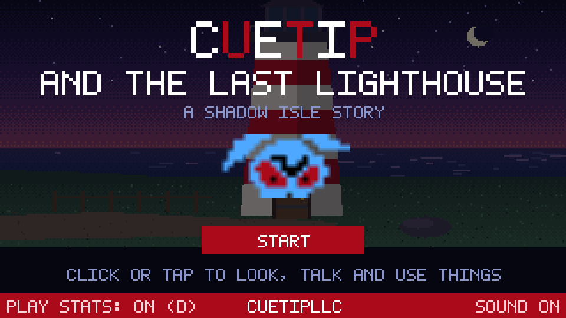
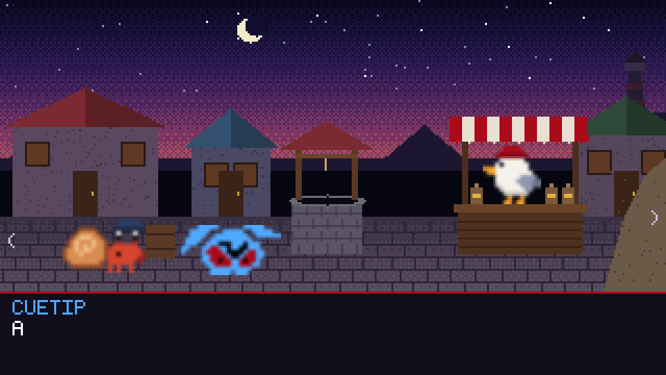
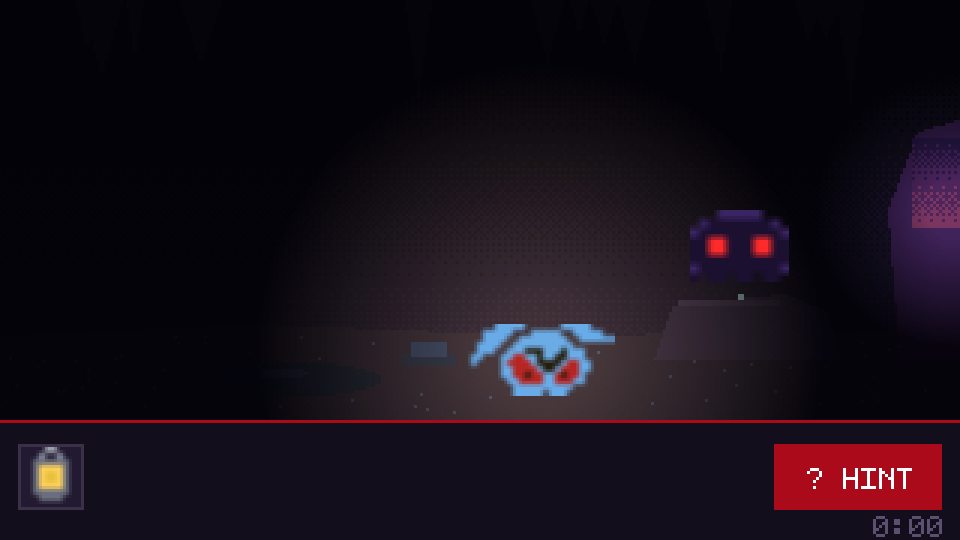

# Cuetip and the Last Lighthouse

A short point-and-click adventure (10–15 minutes) in the browser, and a sequel to
[Shadow Isle](https://github.com/QuintonMcReynolds/shadow-isle). It collects anonymous
gameplay data for an A/B test on hints.



Cuetip washes up in Lanternfall, a fishing village whose lighthouse has gone dark: the
shadows stole its great lens and hid it in the sea cave. Talk to Moss the hermit crab and
Pip the gull, find and combine items, and relight the lamp.



## How to play

Click or tap things to look, talk or pick them up. To use an item, click it in your bag,
then click what to use it on (or another item, to combine them). **? HINT** gives a vague
hint, then a specific one. Progress saves automatically.

## The experiment: does a nudge help stuck players finish?

| | |
|---|---|
| **Arms** | `standard` (hint button only) vs `nudge` (after 75 s without progress, Cuetip also thinks out loud with a hint) |
| **Unit** | Player, assigned by hashing an anonymous browser id, sticky across visits |
| **Primary metric** | Finished the game |
| **Also tracked** | Puzzle-by-puzzle funnel, time to finish, hints per player |

`make report` prints the funnel (where players give up) and completion by arm with
confidence intervals.



## How it's built

- **Game** (`game/`, no build step, about 26 KB zipped): pixel art painted in code with
  crisp fill-only drawing, a 5x7 bitmap font, and WebAudio sound effects.
  - `story.js` holds every scene, puzzle, line and hint as plain data and logic, with no drawing.
  - `lighthouse.js` is the engine: input, walking, dialogue, inventory, saves and telemetry.
- **Telemetry** (`game/telemetry.js`): anonymous id, batched uploads with an offline
  queue, and a one-tap opt-out on the title screen. Events: `game_start`, `scene_enter`,
  `puzzle_solved`, `hint_used`, `game_complete`, and session start and end.
- **Database**: the same Supabase table as Shadow Isle, with rows tagged
  `game = 'last_lighthouse'`. Row-level security lets the public key insert rows but not
  read them. Run `supabase/setup.sql` once.
- **Tests** (`make test`, headless Chrome):
  - A full walkthrough, driven by the same goal list the hint button uses, so every hint
    is checked against a working solution.
  - The real engine played to the ending, plus a click-driven test of the opening.
  - 300 random games, checking that no state can leave a player stuck and that every
    line fits the dialogue box.

## Run it

```
make setup     # Python tools (tests, report)
make dev       # http://localhost:8788/index.html?collector=http://localhost:8788
make test
make package   # dist/last-lighthouse-web.zip for itch.io
make report    # needs .env with SUPABASE_URL and SUPABASE_SERVICE_KEY
```

Made by CuetipLLC.
